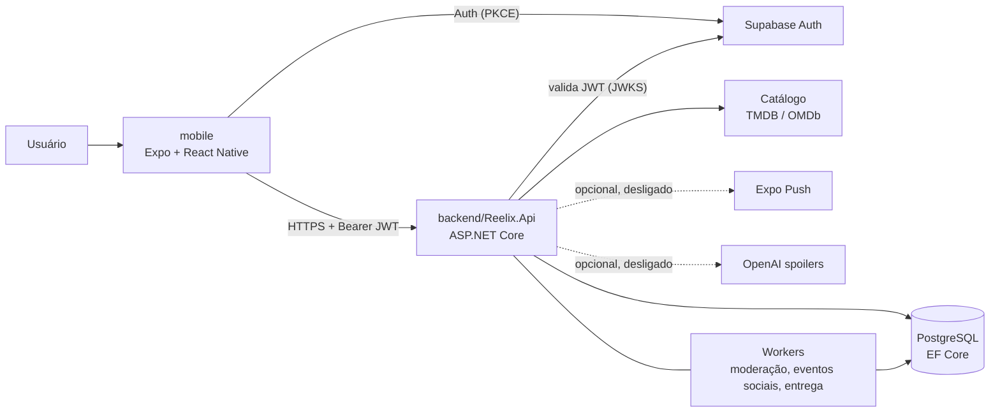

# Arquitetura

> **Público:** agentes de código e pessoas que precisam alterar estrutura, stack ou integrações.
> **Verificado contra o código em:** 2026-11-19.
> Leia `BUSINESS.md` para o contexto de produto e `DEVELOPMENT.md` para as regras de código.

## 1. Visão em uma frase

Monólito modular entregue como um app mobile (`mobile/`, Expo + React Native) apoiado por uma API ASP.NET Core (`backend/`, .NET 10) em quatro projetos de Clean Architecture, com PostgreSQL (EF Core) e identidade no Supabase Auth. O produto implementado cobre autenticação, onboarding, perfil, catálogo (TMDB/OMDb), Home de descoberta, tracking, favoritos e listas, avaliações e comentários, social, notificações, gamificação e a preparação de builds Android; widgets e push remoto ainda não existem. A estrutura interna atual **não** segue integralmente a arquitetura-alvo (§4.2 e §4.3): as dívidas estão em §6.

## 2. Estado atual (implementado)

| Módulo                       | Backend (`backend/`)                                                                        | Mobile (`mobile/src/app`)                                            | Spec                           |
| ---------------------------- | ------------------------------------------------------------------------------------------- | -------------------------------------------------------------------- | ------------------------------ |
| Autenticação e conta         | `GET /api/v1/auth/me`, JWT Bearer do Supabase, conta interna (`user_accounts`)              | `index`, `sign-up`, `forgot-password`, `auth/callback`, `auth/reset-password` | `.specs/0001-authentication.md` |
| Onboarding                   | `/api/v1/onboarding`, gêneros TMDB                                                          | `onboarding`                                                         | `.specs/0002-onboarding.md`     |
| Catálogo                     | `/api/v1/catalog/*`, adaptadores TMDB e OMDb, `catalog_external_references`                 | `search`, `title/...`, `episode/...`                                 | `.specs/0003-catalog.md`        |
| Home e descoberta            | `GET /api/v1/catalog/discover`                                                              | `home`                                                               | `.specs/0004-home-discovery.md` |
| Tracking                     | `/api/v1/tracking/*`                                                                        | `tracking`                                                           | `.specs/0005-tracking.md`       |
| Perfil e privacidade         | `/api/v1/profile`                                                                           | `profile`, `settings`                                                | `.specs/0006-profile.md`        |
| Avaliações e comentários     | `/api/v1/ratings/*`, `/api/v1/comments/*`, worker de moderação (desligado por padrão)       | `my-ratings`, seção de avaliação em `title/...`                      | `.specs/0007-ratings-comments.md` |
| Favoritos, watchlist, listas | `/api/v1/favorites`, `/watchlist`, `/lists`, `/title-status`                                | `lists`                                                              | `.specs/0008-lists-favorites.md` |
| Social                       | `/api/v1/social/*`                                                                          | `social`, `social-profile/[accountId]`                               | `.specs/0009-social.md`         |
| Notificações                 | `/api/v1/notifications/*`, workers de eventos sociais e de entrega                          | `notifications`, `push-registration.ts`                              | `.specs/0010-notifications.md`  |
| Gamificação                  | `/api/v1/gamification/*`                                                                    | `gamification`                                                       | `.specs/0011-gamification.md`   |
| Widgets Android              | —                                                                                           | — (EAS/APK configurados; widget não implementado)                    | `.specs/0012-mobile-widgets.md` |

Limites que valem para todos os módulos (detalhes por spec e em `QA.md`):

- Existir no código **não** prova implantação: migrations, credenciais de provedores e hosting são verificados por ambiente. O único ambiente informado é `Development` (10 migrations aplicadas, até `20261103134321_ExpandFixedAvatars`).
- Push remoto (Expo) vem **desativado** por padrão; a análise de spoilers via OpenAI está **temporariamente desativada**; alertas de catálogo (novos episódios e estreias) não têm fonte nem agendamento.
- Recomendação por IA, posts e reações sociais, denúncias/moderação administrativa, upload de avatar e exclusão/exportação de conta **não** existem.
- Não há observabilidade implantada (métricas, traces, alertas, crash reporting); logs estruturados padrão do ASP.NET Core apenas.
- Não existem testes automatizados do mobile nem E2E; o backend tem 339 testes (xUnit) que passam (`QA.md` §1).

### 2.1 Portas e endereços

| Parte                                 | Endereço local                                  | Observação                                                                    |
| ------------------------------------- | ----------------------------------------------- | ----------------------------------------------------------------------------- |
| API ASP.NET Core (perfil `http`)      | `http://localhost:5035`                         | Swagger em `/swagger`, OpenAPI em `/openapi/v1.json`, só em `Development`     |
| `dev-auth.html` (token de desenvolvimento) | `http://localhost:5035/dev-auth.html`      | Só em `Development`; o navegador fala direto com o Supabase                   |
| Expo (Metro / dev client)             | `8081` (padrão)                                 | CORS de desenvolvimento libera `localhost` e `127.0.0.1` nas portas `8081` e `8087` |
| Expo web                              | `8087` quando usado                             | `react-native-web`; o script `npm run web` existe                             |
| Emulador Android → API                | `http://10.0.2.2:5035`                          | A API precisa escutar em `0.0.0.0` (`--urls http://0.0.0.0:5035`)             |
| PostgreSQL                            | Supabase (hospedado) ou local na `5432`         | Connection string em `ConnectionStrings__Reelix`                              |

## 3. Stack

### 3.1 Instalada e utilizável

| Camada                 | Tecnologia                                                                 | Versão                      | Observação                                                                                  |
| ---------------------- | -------------------------------------------------------------------------- | --------------------------- | ------------------------------------------------------------------------------------------- |
| Runtime backend        | .NET / ASP.NET Core                                                        | `net10.0` (SDK 10.0.x)      | Minimal APIs em `backend/Reelix.Api`; ADR 0001                                              |
| Persistência           | EF Core + Npgsql                                                           | 10.0.13 / 10.0.3            | Migrations em `Reelix.Infrastructure`; ADR 0004; ferramenta local `dotnet-ef` 10.0.13       |
| Banco                  | PostgreSQL (Supabase gerenciado em `Development`)                          | — (17 nos testes)           | RLS ligado nas tabelas; a API usa a própria connection string                               |
| Identidade             | Supabase Auth + `Microsoft.AspNetCore.Authentication.JwtBearer`            | 10.0.13                     | JWKS por padrão; `Supabase:JwtSecret` só para legado HS256; ADR 0003                        |
| Documentação da API    | `Microsoft.AspNetCore.OpenApi` + Swashbuckle                               | 10.0.13 / 10.3.1            | Só em `Development`                                                                         |
| Testes backend         | xUnit, `Mvc.Testing`, Testcontainers PostgreSQL, coverlet                  | 2.9.3 / 10.0.13 / 4.16.0 / 6.0.4 | `backend/Reelix.UnitTests`; ver `TESTING.md`; ADR 0009                                 |
| Mobile                 | Expo SDK 58, React Native, React                                           | `~58.0.23` / 0.88.1 / 19.3.0 | `mobile/`, npm; ADR 0002                                                                   |
| Navegação              | Expo Router (typed routes, React Compiler)                                 | `~58.0.30`                  | Rotas em `mobile/src/app`; `Stack.Protected` por sessão                                     |
| Dados no cliente       | TanStack Query + zod                                                       | 5.105 / 4.6                 | Validação de toda resposta; ADR 0008                                                        |
| Formulários            | React Hook Form + `@hookform/resolvers`                                    | 7.91 / 5.2                  | Hoje só nos formulários de autenticação                                                     |
| Sessão                 | `@supabase/supabase-js` (PKCE) + `expo-secure-store`                       | 2.118 / `~58.0.2`           | Web usa `localStorage`; chave `reelix-auth-session`                                         |
| UI                     | `StyleSheet`, `react-native-svg` (+ transformer), `expo-image`, Sora       | —                           | Tokens em `mobile/src/theme/tokens.ts`; ver `DESIGN_SYSTEM.md`                              |
| Push                   | `expo-notifications` (cliente) e Expo Push API (servidor)                  | `~58.1.8`                   | Desativado por padrão; ADR 0006                                                             |
| Builds                 | EAS (perfis `development` e `preview`, APK interno)                        | —                           | `mobile/eas.json`; Android primeiro; ADR 0010                                               |
| CI                     | GitHub Actions                                                             | —                           | `.github/workflows/ci.yml`; ver `QA.md` §3                                                  |
| Lint                   | `eslint-config-expo` (flat)                                                | ESLint 9                    | `npm run lint` em `mobile/`; backend sem analyzers dedicados                                |
| Catálogo               | TMDB (principal) e OMDb (opcional) via `HttpClient`                        | —                           | ADR 0005                                                                                    |
| IA (opcional)          | OpenAI para classificar spoilers                                           | —                           | Desativada; ADR 0006                                                                        |

### 3.2 Alvo (planejada, ainda não instalada)

| Camada                         | Tecnologia                                  | Uso pretendido                                                         | Onde será decidido |
| ------------------------------ | ------------------------------------------- | ---------------------------------------------------------------------- | ------------------ |
| Testes mobile (unidade/componente) | Jest (`jest-expo`) + React Native Testing Library | Hooks, componentes e fluxos críticos sem rede                  | Specs de testes    |
| E2E                            | Playwright sobre o Expo web                 | Fluxos de entrada, busca, tracking e listas                            | Specs de testes    |
| Testes de arquitetura          | Projeto xUnit com análise de dependências   | Guardar a regra de dependência e as fronteiras de módulo               | Specs de testes    |
| Cobertura                      | coverlet (já referenciado) e piso no CI     | Evitar queda silenciosa de cobertura                                   | Specs de testes    |
| Observabilidade                | A definir (REELIX-016)                      | Métricas, traces, alertas e crash reporting                            | Decisão pendente   |
| Hospedagem da API              | A definir                                   | API e workers continuamente ativos; pré-requisito de push e alertas    | Decisão pendente   |
| Widgets Android                | `expo-widgets` (candidato)                  | Episódios pendentes e próximas estreias (REELIX-013)                   | Spec 0012          |

**Regra:** só descreva como disponível o que estiver em `.csproj`/`package.json` e puder ser executado. Ao instalar algo novo, atualize esta tabela e `QA.md`. A avaliação das tecnologias do projeto de referência (Bun, NestJS, MikroORM, SQS, Prometheus etc.) concluiu pela **não** adoção: nada disso entra sem um caso de uso local e um ADR.

## 4. Arquitetura



O app nunca fala com o banco nem com os provedores de catálogo: tudo passa pela API. O Supabase só autentica (emite o JWT). Os workers rodam **dentro** do processo da API (`BackgroundService`).

### 4.1 Limites entre partes

| Parte                     | Pode referenciar                                      | Não pode referenciar                                         |
| ------------------------- | ----------------------------------------------------- | ------------------------------------------------------------ |
| `Reelix.Domain`           | Nada (nem pacotes)                                    | Qualquer outro projeto, EF, HTTP, SDKs                       |
| `Reelix.Application`      | `Reelix.Domain`; abstrações de DI e logging           | EF Core, `Reelix.Infrastructure`, `Reelix.Api`, detalhes HTTP |
| `Reelix.Infrastructure`   | `Reelix.Domain`, `Reelix.Application`, EF/Npgsql, HTTP | `Reelix.Api`; regra de negócio                               |
| `Reelix.Api`              | `Reelix.Application` e, **só no composition root**, `Reelix.Infrastructure` | Tipos de `Reelix.Domain` em contratos HTTP; regra de negócio |
| `mobile/src/app`          | `components`, `hooks`, `providers`, `services`, `theme`, `schemas` | Backend, `service_role`, segredos de servidor      |
| `mobile/src/services`     | `schemas`/zod, `supabase`, `api-url`                  | Componentes de UI                                            |

A verificação **mecânica** dessas regras (testes de arquitetura) ainda não existe; hoje ela depende de revisão (`code-review`) e da auditoria da skill `refactor-slices`.

### 4.2 Backend: camadas hoje e alvo

**Hoje** (auditoria de 2026-11-19, 131 arquivos `.cs`, ~18,9 mil linhas sem migrations):

| Camada           | Projeto                 | Contém hoje                                                                                                                                                  |
| ---------------- | ----------------------- | ------------------------------------------------------------------------------------------------------------------------------------------------------------ |
| Domínio          | `Reelix.Domain`         | Entidades com invariantes e `private set` (160 setters privados, nenhum público), factories e máquinas de estado (`NotificationDelivery`, `FriendRelationship`) |
| Aplicação        | `Reelix.Application`    | Um `*Service` por módulo (8 a 15 métodos), `*Contracts.cs` que misturam DTOs, ports e exceções, processors dos workers; só `GetAuthenticatedAccount` é um caso de uso por fluxo |
| Infraestrutura   | `Reelix.Infrastructure` | `ReelixDbContext` único (362 linhas), repositórios, configurations EF, adaptadores TMDB/OMDb/OpenAI/Expo, migrations                                          |
| Interface (HTTP) | `Reelix.Api`            | `*Endpoints.cs` por módulo (minimal API com métodos estáticos que injetam o service direto), `Program.cs` (86 linhas, só composição), workers finos, `wwwroot/dev-auth.html`   |

**Fundação transversal já entregue (spec `0013`, `.adrs/0012-use-case-por-fluxo-handler-por-endpoint-e-erros-de-aplicacao.md` (proposto)):** `TimeProvider` injetado (o Domain recebe `now` por parâmetro); `ICurrentUser`/`CurrentUserExtensions` como única leitura do `sub`; port de conta com `FindAsync` (não cria) e `EnsureAsync` (cria); hierarquia `ApplicationError` em `Application/Errors` e **um** mapeamento para `ProblemDetails` por filtro de endpoint (`WithApplicationProblems`, em `Api/Errors`) que os módulos adotam ao migrar; `PageRequest` com políticas nomeadas e `CursorCodec` em `Application/Common`; DI por módulo (`Add<Modulo>Application`/`Add<Modulo>Infrastructure`); registro único dos limites de requisição em `Api/RateLimiting`; `GET /auth/me` em `Api/Authentication` como piloto do padrão de DTO (`Contracts/`) e de handler (`Handlers/`). Os fluxos em si ainda estão nos services gordos até as specs `0014` a `0016`.

**Alvo** (a implementar por specs; registrar ADR ao implementar): fatia vertical por módulo **e por fluxo**, mantendo os quatro projetos.

| Camada         | Alvo                                                                                                                                                                                                   |
| -------------- | ------------------------------------------------------------------------------------------------------------------------------------------------------------------------------------------------------ |
| Domínio        | Entidades e value objects com invariantes; serviços de domínio puros (ex.: regras de conquistas); sem `DateTime.UtcNow` (o instante entra por parâmetro).                                              |
| Aplicação      | `Application/<Modulo>/UseCases/<Fluxo>/<Fluxo>UseCase.cs`: uma classe, um fluxo, um `ExecuteAsync`, com `Command`/`Query` e `Result` ao lado. Ports pequenos em `Ports/` (ISP). Erros tipados e **um** mapeamento para `ProblemDetails`. `TimeProvider` injetado. Sem `HttpStatusCode`/`HttpRequestException`. |
| Infraestrutura | Repositórios só persistem e consultam (nenhuma regra de negócio); adaptadores traduzem erro de provedor em erro de aplicação; um arquivo de DI por módulo; nenhum adaptador depende de service concreto de outro módulo — depende de um port. |
| Interface      | `Api/<Modulo>/<Modulo>Endpoints.cs` só mapeia rotas e metadados OpenAPI; **um handler por endpoint** (`Handlers/<Fluxo>Handler.cs`) que injeta exatamente um use case; identidade por uma abstração única (`ICurrentUser`); DTOs de request/response na Api, nunca tipos de Domain. |
| Fronteiras     | Um módulo não lê tabelas de outro nem injeta o service concreto de outro. Perguntas transversais (ex.: "o título existe no catálogo?") viram **um** port exposto pelo módulo dono (Catalog).            |

Regras de qualidade do alvo: `CancellationToken` em toda operação de I/O; `GET` sem escrita implícita (criar conta/perfil/preferências preguiçosamente passa a ser um passo explícito); paginação e cursor validados em **um** lugar; contrato HTTP público (rotas, status e JSON) preservado durante a refatoração.

### 4.3 Mobile: composição hoje e alvo

**Hoje** (specs `0017` e `0018` aplicadas: fundação de dados, organização por feature e telas finas):

```text
mobile/src/
  app/          # rotas do Expo Router, finas (maior arquivo: 223 linhas): compõem hooks e componentes da feature
  components/   # só ui/ (primitivos: PrimaryButton, IconAction, ModalDialog, ConfirmDialog, UserAvatar, ToggleRow,
                #   Chip, SmallButton, Pager, LoadingState...) e navigation/ (AppHeader, UserDrawer, BackButton)
  features/     # <modulo>/{api,hooks,components}: account, auth, catalog, gamification, home, lists, notifications,
                #   onboarding, profile, ratings, social, tracking; mais query-keys.ts e schemas.ts (zod + RHF) quando há formulário
  lib/          # api-error.ts, http-client.ts, format.ts, pagination.ts, query/ (createQueryClient, stale-time)
  providers/    # auth-provider.tsx, toast-provider.tsx
  services/     # api-url.ts, auth-errors.ts, auth-redirect.ts, push-registration.ts, supabase.ts
  theme/        # tokens.ts
```

Fundação de dados (spec `0017`, ADR `0013`): **um** cliente HTTP (`lib/http-client`, `httpRequest`) é o único ponto com `fetch` à API; erro tipado `ApiError` (`status`, `title`, `detail`) mais erros de rede e de contrato, traduzidos por `toUserMessage`; 401 tratado globalmente no `QueryClient` (`createQueryClient`: sessão local encerrada sem revogar push, cache limpo, um toast, sem retry de 401); fábricas de query key por domínio (`features/<modulo>/query-keys.ts`) com uma chave por recurso (detalhe de título em `catalogQueryKeys.title`); `lib/pagination`, `lib/query/stale-time` e `lib/format` (pt-BR).

Organização por feature (spec `0018`; ADR `XXXX-0018` em `.adrs/`, número definitivo atribuído na integração): telas só compõem. Dados e mutations vivem em hooks de `features/<modulo>/hooks` (cada mutation invalida o cache por prefixo da fábrica); nenhuma rota ou componente usa `useQuery`/`useMutation`/`useQueryClient` nem importa valores da camada `api` (só `import type`; os parâmetros de rota do catálogo vêm de `features/catalog/route-params`). `catalog` é a base e não importa de outras features. Os `Redirect` de sessão saíram das telas (`Stack.Protected` em `_layout.tsx` é a única guarda; ficam só os dois `Redirect` de onboarding em `home` e `onboarding`). Formulários não-auth usam React Hook Form + zod (`features/<modulo>/schemas.ts`); confirmações destrutivas usam `ConfirmDialog`. Imports de assets usam `@/assets/...`.

**Alvo** (specs seguintes): primitivos com evolução visual (`0019`) e telas redesenhadas (`0020`) sobre a base de `components/ui`; testes automatizados (`0022`, `0023`).

Regras que já valem (e a refatoração deve preservar): erros de API/rede/carregamento/salvamento em **toast** (`useToast().showError` ou `useErrorToast`); validação por campo, limites e sucesso **inline**; só tokens de `src/theme/tokens.ts`; copy em pt-BR sem revelar informação sensível; alvos de toque de 44 px; dados reais (sem simular módulos). Detalhes em `DESIGN.md` e `DESIGN_SYSTEM.md`.

### 4.4 Autenticação e identidade (spec `0001`, ADR 0003)

- O app usa o Supabase Auth (PKCE) para cadastro, login, confirmação de e-mail, recuperação e logout. A sessão fica no `expo-secure-store` (iOS/Android) ou `localStorage` (web, não é fronteira de segurança).
- A API valida o JWT (assinatura, emissor, audiência, validade) com os metadados/JWKS do projeto (`Supabase:Url`); `Supabase:JwtSecret` só para legado HS256, exclusivamente no servidor. **Nunca** `service_role` no app.
- O `sub` do JWT identifica o usuário Supabase; a chave interna é `user_accounts.Id`. Operações pessoais resolvem a conta com `IUserAccountRepository.GetOrCreateAsync(sub)` e **nunca** aceitam um ID de dono enviado pelo cliente. Tratar `sub` e o ID interno como iguais já causou falha de dashboard.
- Callback de deep link: `reelix://auth/callback` (PKCE `code`, OTP `token_hash` + `type`, ou sessão direta). O Supabase precisa ter Site URL e Additional Redirect URLs configurados; links de recuperação são de uso único.
- ASP.NET Identity **não** existe e não deve ser adicionado.
- `GET /api/v1/auth/me` retorna o estado básico da conta (lambda inline em `Program.cs`, a ser movida ao módulo de autenticação).

### 4.5 Catálogo e Home (specs `0003` e `0004`, ADR 0005)

- Provedores: TMDB (principal, `Catalog:Tmdb:AccessToken`) e OMDb (opcional, `Catalog:Omdb:ApiKey`), sem fallback automático entre eles; credencial ausente do provedor pedido responde 503. Credenciais só no servidor.
- O banco guarda **referências e dados derivados mínimos** (`catalog_external_references`: `provider`, `external_id`, `content_type` em minúsculas, único por trio, que dão ID interno estável a títulos, temporadas e episódios; mais a duração, os vínculos de gênero e o vínculo episódio → série usados por estatísticas e conquistas). Não há snapshot de metadados nem de imagens. Cache em memória e temporário: descoberta 10 min, gêneros TMDB 6 h.
- A descoberta (`GET /api/v1/catalog/discover`) aceita `type`, `section` (`popular`|`upcoming`), `genreIds` (até 20), `page` (1–100), `provider` e `language`; datas ausentes nunca são estimadas.
- A resposta do OMDb não traz imagens; para TMDB o app exibe logo e aviso de atribuição em Perfil › Créditos. O uso do TMDB gratuito é não comercial (REELIX-018).
- Erros do provedor: 400 validação, 404 título/temporada inexistente, 429 limite, 502/503/504 indisponibilidade ou configuração, sempre em `ProblemDetails`.

### 4.6 Persistência e migrations (ADR 0004)

- Um único `ReelixDbContext` (EF Core + Npgsql) para todos os módulos; migrations em `backend/Reelix.Infrastructure/Persistence/Migrations`. A API **não** aplica migrations ao subir.
- O CI gera o script idempotente (`dotnet-ef migrations script --idempotent`) como artefato `reelix-idempotent-migrations`; ele é revisado manualmente e **não** é aplicado pelo CI.
- Aplicar em desenvolvimento: `dotnet tool run dotnet-ef database update --project backend\Reelix.Infrastructure\Reelix.Infrastructure.csproj --startup-project backend\Reelix.Api\Reelix.Api.csproj`, com a connection string apontando explicitamente para o banco alvo. Nunca contra banco compartilhado sem autorização.
- RLS está habilitado nas tabelas e os papéis da Data API do Supabase não têm acesso direto; só a API acessa o PostgreSQL com a connection string do servidor.
- Tempo em UTC; IDs de provedor guardados ao lado dos IDs internos; unicidade e FKs protegem integridade (ex.: tracking único por conta e item).

### 4.7 Tracking, listas e favoritos (specs `0005` e `0008`)

- O registro de tracking é único por conta e ID interno do item; `PUT` repetido é idempotente e corrige `watchedAt`, `DELETE` repetido continua com sucesso. O cliente nunca envia o ID da conta.
- Histórico paginado (`page`, `pageSize`, `type`, `sort`); episódios identificados pelo GUID interno (número pode ser nulo; especiais = temporada 0).
- Progresso da série (`GET /api/v1/tracking/series/{seriesId}/progress`) agrega o inventário válido do provedor por GUID único, exclui temporadas negativas e itens com data futura (UTC), mantém episódios sem data como disponíveis e **nunca** infere "assistido" pela data de lançamento. Sem inventário, totais e percentual são nulos.
- Favoritos, watchlist e listas privadas são recursos independentes, com paginação, edição, exclusão e ordenação; alterações invalidam o cache da Home.

### 4.8 Avaliações, comentários e spoilers (spec `0007`, ADR 0006)

Notas de meia estrela (0 a 5), comentários privados ou públicos, edição/exclusão próprias, ocultação e revelação explícita de spoilers (inclusive em episódios). A classificação automática de spoilers via OpenAI exige consentimento explícito por comentário, segredo só no servidor e está desativada (`OpenAI:SpoilerAnalysis:Enabled` e `TemporarilyDisabled`); a sinalização manual funciona sem ela. Denúncias e moderação administrativa estão fora do escopo (REELIX-010).

### 4.9 Social e notificações (specs `0009` e `0010`, ADR 0007)

- Amizades por solicitação, busca controlada, feed paginado e perfil contextual, com consentimentos separados para histórico, avaliações e favoritos; limites de requisição seletivos (`social-search`, `social-write`, `reviews-write`, `notifications-write`).
- Fluxo Social → Notificações por **outbox**: eventos em `social_events` e controle de processamento em `notification_processed_social_events`, consumidos por worker com `FOR UPDATE SKIP LOCKED`. Entregas push usam claim/lease persistente, retry limitado e leitura de receipts.
- A inbox funciona com push desativado. Registro de dispositivo responde indisponível quando `ExpoPush__Enabled=false`. `deepLink` de notificação só aceita destinos internos permitidos (`/social`, `/notifications`).
- **Estrutura (spec `0014`, ADR `0014`):** `Notifications` tem 7 casos de uso (`Application/Notifications/UseCases/`, um por rota) e 2 casos de uso de worker (`Application/Notifications/Workers/`: `ProcessSocialEventsUseCase`, `DeliverPushNotificationsUseCase`), 7 handlers em `Api/Notifications/Handlers/` e os workers finos em `Api/Notifications/Workers/` (1 caso de uso por ciclo). A regra vive no Domain, em serviços puros e testáveis sem banco: `SocialEventNotificationPlanner` (evento + relação + preferência + dispositivos ⇒ desfecho `created`/`disabled`/`obsolete`, conteúdo e entregas), `PushRetryPolicy` (lease de 2 min, backoff `5·2^(n-1)` s com jitter recebido por parâmetro, receipts `15·2^min(n,5)` min, expiração em 24 h) e `PushDeliveryEligibility` (motivo de cancelamento). Os repositórios viraram adaptadores por port estreito (≤ 5 operações) só de persistência; o limite transacional do outbox e das filas de entrega é um port (`ISocialEventOutbox`, `IPushDeliveryQueue`: lote reservado com `FOR UPDATE SKIP LOCKED` e confirmado). O fornecedor push fica atrás de `IPushSender`; o adaptador Expo traduz erro de transporte/timeout/JSON nos mesmos códigos persistidos (`expo_transport_error`, `expo_timeout`). `GET /notifications/preferences`, inbox, contagem, marcar lido e remover dispositivo não gravam (conta ausente = sem linha criada; preferências ausentes = tudo desligado).

### 4.10 Gamificação e perfil (specs `0006` e `0011`)

Conquistas determinísticas, estatísticas com estimativa de duração e ranking mensal entre amigos com opt-in. **Estrutura (spec `0014`):** 5 casos de uso (`Application/Gamification/UseCases/`), 5 handlers (`Api/Gamification/Handlers/`) e a regra de conquistas no serviço de domínio puro `AchievementEvaluator` (definições ativas + conquistas existentes + estatísticas ⇒ conceder, reativar ou revogar). A **única escrita** de `user_achievements` é o passo explícito `AchievementReconciler` (Application), dentro de uma transação `RepeatableRead` com lock da conta (port `IAchievementReconciliationTransaction`); estatísticas, ranking e badges são ports de leitura. **Decisão Q1 (opção A, 2026-11-19):** `GET /gamification/dashboard` e `GET /gamification/users/{id}/badges` continuam acionando a reconciliação (gravam, inclusive na conta consultada nos badges); `GET /gamification/statistics` e `/friends/ranking` não gravam (conta ausente = resposta de conta nova). Mudar o gatilho da reconciliação (tracking, worker) altera quando `firstEarnedAt`/`lastRevokedAt` são carimbados e é spec própria. Achados do Batch 0 preservados: o ranking de quem tem o ranking ligado responde 500 (a ordenação da página não é traduzida pelo EF Core) e dashboards simultâneos da mesma conta podem falhar com 40001 (`RepeatableRead` + lock). Perfil: nome (até 50), biografia (até 280), privacidade (`profileIsPublic`, `favoritesArePublic`, `watchHistoryIsPublic`, todos `false` por padrão) e avatar fixo por chave (`avatarKey`) ou iniciais; upload de imagem não existe.

### 4.11 Rotas HTTP

Todas exigem autenticação, exceto o que está marcado. Prefixo `/api/v1`.

| Módulo           | Rotas                                                                                                                                                                                                                                          |
| ---------------- | ---------------------------------------------------------------------------------------------------------------------------------------------------------------------------------------------------------------------------------------------- |
| Auth             | `GET /auth/me`; `GET /dev/auth/config` (só `Development`)                                                                                                                                                                                      |
| Catalog          | `GET /catalog/genres`, `/catalog/search`, `/catalog/discover`, `/catalog/{provider}/{contentType}/{externalId}`, `/catalog/{provider}/series/{id}/seasons`, `/catalog/{provider}/series/{id}/seasons/{n}`                                      |
| Onboarding       | `GET /onboarding`; `PUT /onboarding/progress`; `POST /onboarding/complete`                                                                                                                                                                     |
| Profile          | `GET /profile`; `PUT /profile`; `GET /profile/{accountId}` (só perfil público)                                                                                                                                                                 |
| Tracking         | `GET /tracking/history`, `/tracking/series`, `/tracking/series/{id}/progress`, `/tracking/movies/{id}`; `PUT`/`DELETE /tracking/movies/{id}`; `PUT`/`DELETE /tracking/series/{id}/episodes/{episodeId}`; consultas de temporada/pendentes     |
| Lists            | `GET`/`PUT`/`DELETE /favorites`, `/watchlist`; `POST /title-status`; `GET`/`POST /lists`; `GET`/`PUT`/`DELETE /lists/{id}`; `PUT`/`DELETE /lists/{id}/titles/{titleId}`; `PUT /lists/{id}/titles/order`                                        |
| Ratings/Comments | `GET /ratings/mine`; `GET`/`PUT`/`DELETE /ratings/{targetType}/{targetId}`; `GET`/`POST /comments/{targetType}/{targetId}`; `PUT`/`DELETE /comments/{id}`; `POST /comments/{id}/reveal`                                                       |
| Social           | `GET /social/users`; `GET`/`POST /social/friend-requests`; `PUT .../{id}/accept`, `.../decline`; `DELETE .../{id}`; `GET /social/friends`; `GET /social/friends/{accountId}/profile`, `/activities`; `DELETE /social/friends/{id}`; `GET /social/feed` |
| Notifications    | `GET`/`PUT /notifications/preferences`; `POST /notifications/devices`; `DELETE /notifications/devices/{id}`; `GET /notifications/inbox`, `/inbox/unread-count`; `PUT /notifications/inbox/{id}/read`                                           |
| Gamification     | `GET /gamification/dashboard`, `/statistics`, `/friends/ranking`, `/users/{accountId}/badges`; `PUT /gamification/preferences`                                                                                                                  |

Convenções de contrato estão em `DEVELOPMENT.md` §13.

### 4.12 Configuração (variáveis e segredos)

| Variável                                              | Onde             | Obrigatória | Segredo? | Uso                                                              |
| ----------------------------------------------------- | ---------------- | ----------- | -------- | ---------------------------------------------------------------- |
| `Supabase__Url`                                       | API              | Sim         | Não      | Emissor e metadados JWKS                                         |
| `Supabase__Audience`                                  | API              | Não         | Não      | Audiência validada (padrão `authenticated`)                      |
| `Supabase__JwtSecret`                                 | API              | Só legado HS256 | **Sim** | Segredo de assinatura legado (jamais `service_role`)          |
| `ConnectionStrings__Reelix`                           | API              | Sim         | **Sim**  | PostgreSQL                                                       |
| `Cors__AllowedOrigins__0`…                            | API              | Clientes web | Não     | Origem HTTPS exata; sem curingas                                 |
| `Catalog__Tmdb__AccessToken`                          | API              | Para TMDB   | **Sim**  | Read Access Token                                                |
| `Catalog__Omdb__ApiKey`                               | API              | Para OMDb   | **Sim**  | Chave OMDb                                                       |
| `OpenAI__SpoilerAnalysis__{Enabled,TemporarilyDisabled,ApiKey,Model,TimeoutSeconds}` | API | Não | `ApiKey` **sim** | Classificação de spoilers (desativada)          |
| `ExpoPush__{Enabled,ProjectId,AccessToken,MaxAttempts}` | API            | Não         | `AccessToken` **sim** | Push remoto (desativado)                            |
| `EXPO_PUBLIC_SUPABASE_URL`                            | `mobile/.env`    | Sim         | Não      | URL pública do projeto                                           |
| `EXPO_PUBLIC_SUPABASE_PUBLISHABLE_KEY`                | `mobile/.env`    | Sim         | Não (pública) | Chave `publishable` (ou `anon` legada)                      |
| `EXPO_PUBLIC_API_URL`                                 | `mobile/.env`    | Sim         | Não      | URL da API; HTTPS fora de `__DEV__`/rede local                   |

Segredos do servidor ficam em User Secrets (desenvolvimento) ou no gerenciador de segredos do hosting; **nunca** em `appsettings*.json`, `mobile/.env.example`, no Git, em logs ou no app. `EXPO_PUBLIC_*` vai para o bundle e é público.

## 5. Decisões já tomadas

| Decisão                                                                              | Motivo                                                                                   | Consequência                                                                                   |
| ------------------------------------------------------------------------------------ | ---------------------------------------------------------------------------------------- | ---------------------------------------------------------------------------------------------- |
| Monólito modular com Clean Architecture em quatro projetos — ADR 0001                | Simplicidade e regra de dependência clara, sem microsserviços                            | Um deploy e um `DbContext`; fronteiras de módulo dependem de disciplina e de testes futuros    |
| App Expo/React Native com Expo Router — ADR 0002                                     | Um código para Android e iOS, deep links e builds por EAS                                | Dependências nativas exigem development build; Expo Go não basta                               |
| Supabase Auth + validação de JWT na API, sem ASP.NET Identity — ADR 0003             | Não manter senhas nem sistema próprio de identidade                                      | Chaves públicas no app; `service_role` proibida; callback e Site URL por ambiente              |
| PostgreSQL + EF Core/Npgsql, migrations versionadas e script idempotente — ADR 0004  | Persistência relacional com histórico revisável                                          | CI não aplica schema; cada novo ambiente repete a validação                                    |
| Catálogo por adaptadores TMDB/OMDb, só referências persistidas — ADR 0005            | Direitos de uso e troca de provedor                                                      | Sem snapshot; atribuição e termos pendentes de confirmação comercial                           |
| Push e análise de spoilers desativados por padrão, atrás de configuração — ADR 0006  | Dependem de credenciais, custo e hosting                                                 | Inbox e comentários funcionam sem eles                                                         |
| Outbox de eventos sociais para notificações — ADR 0007                               | Desacoplar Social de Notificações sem broker                                             | Workers no processo da API; sem fila durável externa                                           |
| TanStack Query + zod para estado de servidor no mobile — ADR 0008                    | Cache, retry e validação de contrato                                                     | Tipos escritos à mão (sem codegen OpenAPI); chaves de cache precisam de disciplina             |
| Testcontainers PostgreSQL para testes de integração — ADR 0009                       | Validar migrations, isolamento e concorrência em banco real                              | Docker necessário para parte da suíte                                                          |
| Widgets Android primeiro, iOS adiado — ADR 0010                                      | Só há dispositivo e build Android validados                                              | Widget ainda não implementado                                                                  |

ADRs vivem em `./.adrs/` (`0001` a `0011`, registros retroativos). Crie `./.adrs/NNNN-titulo.md` ao tomar decisões estruturais (template em `RULES.md`).

## 6. Dívidas e lacunas conhecidas

### 6.1 Arquitetura do backend (auditoria de 2026-11-19)

1. ~~**Regra de negócio em repositórios:**~~ **Resolvido para Gamification e Notifications (spec `0014`):** a regra de conquistas, a decisão de evento social, o backoff e o cancelamento de entregas estão no Domain (`AchievementEvaluator`, `SocialEventNotificationPlanner`, `PushRetryPolicy`, `PushDeliveryEligibility`) e são testados sem banco; os repositórios deixaram de existir. A escrita do `GET /gamification/dashboard` e de `/users/{id}/badges` segue por decisão (Q1, opção A), isolada em `AchievementReconciler`.
2. **Sem caso de uso por fluxo:** serviços com 8 a 15 métodos (`TrackingService` 11, `UserListsService` ~15); endpoints repetem a extração do `sub` (`TryGetUserId` em 8 arquivos, `Results.Unauthorized` ~63 vezes), o parse de enums e o mapeamento de exceção, e injetam o service direto.
3. **Erros por exceção sem contrato único (parcial):** a hierarquia `ApplicationError` e o mapeador único existem (spec `0013`), mas os endpoints ainda têm `try/catch` próprio: `InvalidOperationException` vira 409 em Social e 503 em Notifications; `ToUserMessage()` é aplicado em alguns módulos e não em outros (Social ainda vaza o sufixo `(Parameter '…')` até a `0016`; Gamification e Notifications já foram migrados pela `0014`).
4. ~~**Sem abstração de tempo**~~ **Resolvido (spec `0013`):** `TimeProvider` é registrado e injetado, o Domain recebe o instante por parâmetro e nenhum arquivo de Domain, Application ou Infrastructure usa `DateTime(Offset).UtcNow`; os testes usam um relógio fixo (`FixedTimeProvider`, escrito à mão).
5. **Application conhece detalhes de HTTP e de fornecedor (parcial):** `CatalogProviderException` carrega `HttpStatusCode`/`RetryAfter`; `TrackingCatalog` (Infrastructure) depende do `CatalogService` concreto. ~~processors capturam `HttpRequestException`; `IExpoPushClient` é um port com nome de fornecedor~~ **Resolvido em Notifications (spec `0014`):** `IPushSender` com resultados sem nome de fornecedor; o adaptador Expo traduz o erro de transporte e a Application não referencia `HttpRequestException`.
6. **Domain vaza até a Api:** `SocialService` devolve `FriendRelationship`; endpoints usam `ReviewTargetType`, `FriendRelationshipStatus` e `TrackingItemType` de `Reelix.Domain`.
7. **DTOs de Application como contrato HTTP** e `*Contracts.cs` misturando DTOs, ports e exceções (`CatalogContracts` 217 linhas): mudar a API pública exige mudar Application.
8. **Repositórios gordos e acesso cruzado de tabelas (parcial):** `SocialRepository` 429; `IUserListsRepository` com 16 operações; quatro variantes de "o título existe no catálogo"; `SocialRepository` lê tabelas de outros módulos. ~~`NotificationsRepository` 500 linhas, `GamificationRepository` 422~~ **Resolvido em Gamification e Notifications (spec `0014`):** `IGamificationRepository` e `INotificationsRepository` deixaram de existir, substituídos por adaptadores de ≤ 5 operações por port. As leituras de `tracking_records`, `friend_relationships`, `user_profiles`, catálogo e `social_events` por esses dois módulos continuam nos adaptadores (`GamificationStatisticsReader`, `MonthlyRankingReader`, `FriendshipLookup`, `SocialEventOutbox`) até a spec `0016` trocá-las por ports dos módulos donos.
9. **Duplicação transversal (parcial):** `ValidatePage`, cursor base64 e o cache estático de `CatalogGenreService` foram unificados (`PagePolicy`/`PageRequest`, `CursorCodec`, `ICatalogGenreCache`); os limites de página continuam diferentes por fluxo de propósito. Resta `GetOrCreateAsync` 36 vezes, que `0014` a `0016` trocam por `FindAsync`/`EnsureAsync`.
10. ~~**Composição irregular**~~ **Resolvido (spec `0013`):** DI por módulo no mesmo padrão e nível de pasta (sem nome de classe repetido), `Program.cs` com 86 linhas, uma tabela de rate limit e opções TMDB/OMDb com `ValidateOnStart` (credencial ausente continua válida; só valor malformado derruba a partida).

**Já está bem feito (preservar):** grafo de projetos correto; Application sem EF; ports em Application; Domain rico e sem dependências; workers finos; outbox Social → Notifications; opções de Expo/OpenAI validadas na partida; isolamento entre contas testado em PostgreSQL real; interfaces de catálogo segregadas.

### 6.2 Arquitetura do mobile (auditoria de 2026-11-19)

1. ~~**Telas "god component":** `lists.tsx` 995 linhas, `tracking.tsx` 903, `onboarding.tsx` 748, `gamification.tsx` 638, `rating-review-section.tsx` 771; dados, estado de formulário e UI no mesmo arquivo.~~ **Resolvido pela spec `0018`:** rotas de no máximo 223 linhas (maior: `social-profile/[accountId].tsx`), componentes de feature de no máximo 238 e hooks de no máximo 186; cada tela virou composição de hooks e componentes de `features/<modulo>/`.
2. ~~**Três clientes HTTP duplicados** (`apiRequest`, `trackingRequest`, `request`) e `api-client.ts` monolítico de 848 linhas (schemas e fetch de ~12 domínios).~~ **Resolvido pela spec `0017`:** `lib/http-client` único; `api-client.ts` dividido por domínio em `features/<modulo>/api/`. O barrel temporário foi removido pela `0018`.
3. ~~**Camada de hooks quase inexistente:** só `use-tracking.ts`.~~ **Resolvido pela spec `0018`:** hooks de query/mutation por feature em `features/<modulo>/hooks` (0 `useQuery`/`useMutation`/`useQueryClient` em rotas e componentes). ~~93 `queryKey` inline sem fábrica, com o mesmo título sob chaves diferentes e cache fragmentado; `getNextPageParam` reescrito 10 vezes.~~ **Resolvido pela `0017`:** fábricas por domínio, uma chave por título, `lib/pagination`.
4. ~~**Erro e sessão espalhados:** `useErrorToast` 79 vezes, "Sua sessão expirou" 11 vezes, sem `ApiError` tipado nem tratamento global de 401.~~ **Resolvido pela spec `0017`:** `ApiError`, `toUserMessage`, mensagem de sessão em uma constante e 401 global no `QueryClient` (`useErrorToast` segue em uso e ignora 401).
5. ~~**Guardas duplicadas:** 8 telas repetem `Redirect` apesar de `Stack.Protected`.~~ **Resolvido pela spec `0018`:** os 7 `Redirect` de sessão saíram; `Stack.Protected` é a única guarda de sessão (restam os 2 `Redirect` de onboarding, que não são de sessão).
6. ~~**Primitivos de UI mal localizados e duplicados:** `PrimaryButton` em `components/auth/`; toggles, chips, pager e estados de loading/erro reimplementados por tela.~~ **Resolvido pela spec `0018`:** primitivos em `components/ui` (as cópias com aparências diferentes foram preservadas por `variant`; unificar é da `0019`).
7. ~~**Formulários não-auth sem zod/RHF** (validação manual com `useState`).~~ **Resolvido pela spec `0018`:** lists, profile, tracking (data assistida), ratings (comentário) e onboarding usam React Hook Form + zod; buscas de campo único sem envio (`search`, busca do social, busca de títulos) continuam fora do RHF por premissa da spec.
8. ~~**Formatação e paginação duplicadas** (~20 usos de `Intl.DateTimeFormat`/`toLocale*`), sem módulo `lib/`.~~ **Resolvido pelas specs `0017` e `0018`:** `lib/format`, `lib/pagination` e `lib/query/stale-time`; as três cópias de iniciais viraram `getInitials`.

**Já está bem feito (preservar):** disciplina de tokens (zero hex em telas e componentes), validação zod de toda resposta, autenticação (PKCE, `Stack.Protected`, signOut que revoga push e limpa cache), convenção toast × inline cumprida, acessibilidade acima da média (164 `accessibilityRole`, 103 `accessibilityLabel`), `trackingQueryKeys` como modelo de fábrica.

### 6.3 Produto, operação e processo (backlog REELIX)

Itens rastreados desde a auditoria de 2026-11-04 (o detalhamento longo ficou no histórico do Git; o estado verificável está em `QA.md`). "Aguardando decisão" não é defeito.

| ID           | Título                                                         | Prioridade | Status                  | Dependência / próxima ação                                                              |
| ------------ | -------------------------------------------------------------- | ---------- | ----------------------- | --------------------------------------------------------------------------------------- |
| REELIX-001   | Validar e aplicar migrations por ambiente                      | Alta       | Concluído (só `Development`) | Repetir inventário e smoke ao criar outro ambiente                                  |
| REELIX-002   | Testes de integração e autorização da API                      | Alta       | Concluído (escopo atual) | Ampliar com a spec de testes                                                            |
| REELIX-003   | Testes automatizados do app mobile                             | Alta       | **Pendente** (a documentação anterior marcava "Concluído", mas não existe runner) | Specs de testes (Jest/RNTL e Playwright) |
| REELIX-004   | Quality gates e supply chain no CI                             | Alta       | Concluído (escopo atual) | PR #11 em `main`, 4/4 checks; branch protection exige PR e checks `backend`/`mobile`    |
| REELIX-005   | Validar builds e release nativos                               | Média      | Parcial                 | Falta callback de cadastro, deep links internos e build de release (variáveis EAS e API HTTPS) |
| REELIX-006   | Habilitar e validar push remoto                                | Média      | Bloqueado               | EAS/APNs/FCM, segredo Expo e hosting contínuo                                           |
| REELIX-007   | Fonte e agendamento de alertas de catálogo                     | Média      | Bloqueado               | Decisão de fonte e scheduler; REELIX-006                                                |
| REELIX-008   | Ciclo de vida, exportação e exclusão da conta                  | Alta       | Aguardando decisão      | Decisão de produto/privacidade (LGPD)                                                   |
| REELIX-009   | Upload de avatar (ou formalizar avatares fixos)                | Baixa      | Aguardando decisão      | Decisão de produto                                                                      |
| REELIX-010   | Denúncias e moderação administrativa                           | Média      | Aguardando decisão      | Política de conteúdo e operação                                                         |
| REELIX-011   | Reativar análise de spoilers por IA                            | Baixa      | Aguardando decisão      | Custo, consentimento, segredo no servidor                                               |
| REELIX-012   | Recomendações por IA                                           | Baixa      | Aguardando decisão      | Decisão de produto, provedor e orçamento                                                |
| REELIX-013   | Widgets Android                                                | Baixa      | Parcial                 | Validar o APK de development; integrar `expo-widgets`; iOS adiado                       |
| REELIX-014   | Destinos de navegação de notificações                          | —          | Resolvido               | Novas categorias definem o próprio destino                                              |
| REELIX-015   | Validação manual de acessibilidade e UX                        | Média      | Parcial                 | TalkBack/VoiceOver, contraste, Dynamic Type                                             |
| REELIX-016   | Logging, métricas e alertas operacionais                       | Média      | Aguardando decisão      | Hosting e stack de observabilidade                                                      |
| REELIX-017   | Social com posts e reações                                     | Baixa      | Aguardando decisão      | Decisão de produto; REELIX-010                                                          |
| REELIX-018   | Termos e uso comercial dos dados de catálogo                   | Alta       | Aguardando decisão      | Confirmar TMDB/OMDb para a finalidade comercial                                         |
| REELIX-019   | Advisories moderados do `npm audit` (21)                       | Média      | Bloqueado               | Release compatível do Expo; não forçar downgrade                                        |

Outras lacunas: sem observabilidade nem crash reporting (REELIX-016); contadores de rate limit por instância (`AddRateLimiter` em memória); push e workers exigem hosting contínuo; só existe `Development`; `adb` não está instalado na máquina de desenvolvimento (validação Android é feita no dispositivo Samsung pelo usuário).

## 7. Regras ao evoluir a arquitetura

- O app fala com a API; segredos (`ConnectionStrings__Reelix`, tokens de provedores, `Supabase__JwtSecret`) ficam no servidor e nunca no bundle nem em `appsettings*.json`.
- Adicione pacote NuGet ao projeto que o consome (não ao `Domain`); adicione dependência npm só em `mobile/` e com `npx expo install` quando for módulo Expo.
- Provedores externos (catálogo, push, IA) ficam atrás de ports em `Application` e adaptadores em `Infrastructure`; nenhuma regra de negócio depende de TMDB, OMDb, OpenAI ou Expo.
- Toda integração externa tem timeout, retry limitado, erro tipado e logs sem PII ou segredo.
- Migration nova: gere com `dotnet ef`, revise o SQL, mantenha o `Down`, não edite migration já aplicada em algum banco e não aplique em ambiente compartilhado sem autorização.
- Mudança de contrato HTTP público (rota, status, JSON) exige atualizar o cliente mobile (schemas zod), `.specs/` e esta doc na mesma mudança.
- Não crie ASP.NET Identity, cliente de banco no app, segunda API ou segundo ORM.
- Decisão estrutural (camadas, dependência relevante, contrato entre partes, modelo de dados, autenticação, estratégia de testes) gera ADR em `./.adrs/`.
