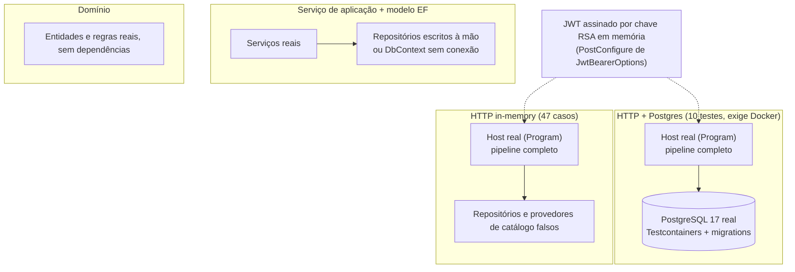
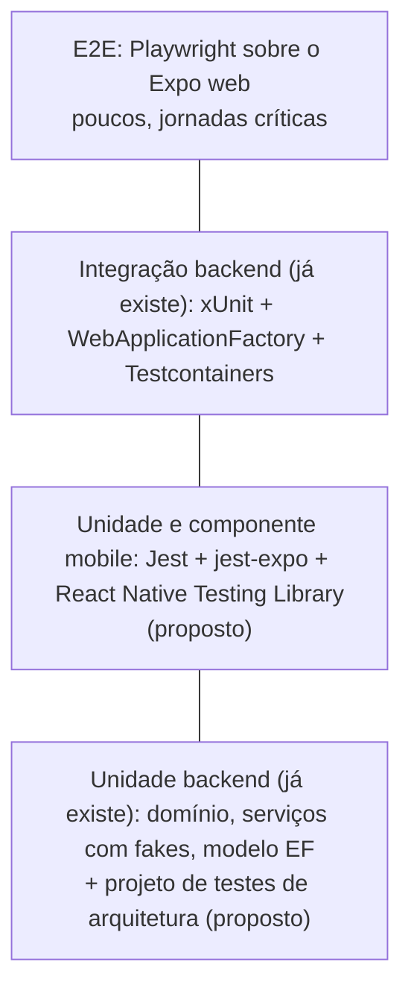
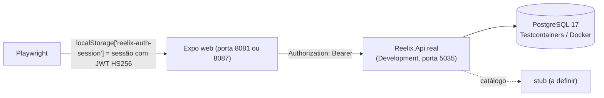

# TESTING.md — Como os testes funcionam e como a arquitetura é exercitada

> **Público:** quem avalia a estratégia de testes e quem vai escrever testes novos.
> **Verificado contra o código em:** 2026-11-19, commit `1baace9` (`backend/Reelix.UnitTests/`, `backend/Reelix.Api/Program.cs`, `backend/Reelix.Infrastructure/DependencyInjection.cs`, `.github/workflows/ci.yml`, `mobile/package.json`, `mobile/src/services/`).
> **Leitura relacionada:** `QA.md` (gates, baseline e registro de cada verificação), `ARCHITECTURE.md` §3.2 (stack-alvo de testes), `../.specs/0001-authentication.md` (variáveis e Supabase), `../.specs/0003-catalog.md` (provedores de catálogo).

`QA.md` diz **o que rodar** e **o que já foi verificado**. Este documento mostra **como** os testes funcionam: que peças da arquitetura cada camada usa de verdade e quais substitui, como o ambiente é montado, que convenções seguir e o que ainda não existe (mobile, E2E, arquitetura, cobertura), com a estratégia-alvo para cada lacuna.

**Em uma frase:** hoje o Reelix tem uma suíte backend sólida (xUnit, 202 testes, todos aprovados em 2026-11-19) e **nenhum teste automatizado do app mobile**; o mobile só passa por `lint` e `tsc`, e a verificação funcional é manual (`QA.md` §5).

## 1. O princípio: quanto mais alto o teste, mais componentes reais

Todos os testes rodam no mesmo projeto, `backend/Reelix.UnitTests`, com xUnit puro. O nome do projeto engana: ele mistura quatro camadas (ver §1.1). Não existe projeto separado de integração.

### 1.1 Quem é real e quem é substituído, por camada

| Componente | Domínio | Serviço de aplicação (fakes à mão) | Modelo / migration EF (sem conexão) | HTTP in-memory (fakes) | HTTP + Postgres (Testcontainers) | Produção |
| --- | --- | --- | --- | --- | --- | --- |
| Entidades e regras (`Reelix.Domain`) | **Reais** | Reais | Reais | Reais | Reais | Reais |
| Casos de uso (`Reelix.Application`) | — | **Reais** | — | Reais (os que a rota usa) | Reais | Reais |
| Repositórios / `ReelixDbContext` | — | Fake escrito à mão (`Stub*`, `Fake*`) | **Real**, mas sem abrir conexão (string `Host=localhost;...` nunca usada; comandos interceptados) | Fake só para conta, perfil e preferências; os demais ficam registrados como em produção e nenhum teste dessa classe os exercita (rotas só rejeitadas antes do handler ou atendidas pelos fakes) | **Real** (`DbContext` trocado para o contêiner) | Real |
| PostgreSQL | — | — | Não é consultado | Não é consultado | **Real**: `postgres:17-alpine`, `Database.MigrateAsync()` | Supabase (gerenciado) |
| Pipeline HTTP (roteamento, CORS, autenticação, autorização, rate limiter, Swagger) | — | — | — | **Real** (`Program` inteiro, ambiente `Development`) | **Real** | Real |
| Validação de JWT | — | — | — | **Real**, com a chave de assinatura trocada por RSA em memória | **Real**, mesma troca | Chaves do Supabase (JWKS) ou segredo HS256 legado |
| Catálogo TMDB / OMDb | — | `ICatalogProvider` falso; adaptadores testados à parte com `HttpMessageHandler` falso | — | `ICatalogProvider` e `ICatalogGenreProvider` falsos | Registro de produção, sem credencial e **não exercitado** (a referência de catálogo é inserida direto no banco) | HTTP real (`api.themoviedb.org`, `www.omdbapi.com`) |
| Expo Push e OpenAI (moderação) | — | Só os adaptadores, com `HttpMessageHandler` falso (`ExpoPushClientTests`, `CommentModerationTests`) | — | Não exercitados | Não exercitados | HTTP real |
| Supabase Auth (emissão do token) | — | — | — | **Substituído**: o teste assina o próprio JWT | **Substituído** | Real |
| Workers (`CommentModerationWorker`, `SocialNotificationWorker`, `NotificationDeliveryWorker`) | — | — | — | Registrados pelo `Program`, sem teste dirigido | Idem | Reais |
| App mobile | — | — | — | — | — | Real |

A regra que a suíte segue: **código nosso roda de verdade**; só o que é de terceiros (Supabase Auth, TMDB, OMDb, Expo, OpenAI) é substituído, e o banco só é substituído onde o teste não precisa dele. A camada de cima (HTTP + Postgres) é a única que prova isolamento entre contas com SQL de verdade.

### 1.2 O que cada camada cobre hoje

| Camada | Onde está | Prova |
| --- | --- | --- |
| Domínio | `Domain/` (9 arquivos: conta, perfil, avaliação, comentário, listas, tracking, amizade, notificação, gamificação) | Invariantes e validações das entidades (`Create` rejeita nota fora de meia estrela, nome inválido, etc.) |
| Serviço de aplicação | `Catalog/CatalogServiceTests`, `Lists/UserListsServiceTests`, `Ratings/RatingsCommentsServiceTests`, `Social/SocialServiceTests`, `Tracking/TrackingServiceTests`, `Gamification/GamificationPersistenceTests` (parte de serviço) | Orquestração: identidade resolvida a partir do `sub`, idempotência, paginação, escopo por conta |
| Adaptador de provedor externo | `Catalog/CatalogProviderTests`, `Notifications/ExpoPushClientTests`, `Ratings/CommentModerationTests` | Mapeamento de resposta, autenticação do pedido, erro sanitizado, limite de taxa, sem expor corpo do provedor |
| Modelo / migration EF | `*PersistenceTests`, `*PersistenceModelTests`, `*MigrationTests`, `ListsPersistenceConfigurationTests` | Índices únicos, `CHECK`, comportamento de `DELETE`, RLS e `REVOKE` presentes na migration, SQL emitido (sem executar) |
| HTTP in-memory | `Api/AuthenticationEndpointTests` | 401 sem token (32 rotas em `[Theory]`), JWT inválido (emissor, audiência, assinatura, expirado), Swagger expõe as rotas, CORS de origem web configurada, `dev-auth.html` em Development, perfil/onboarding/catálogo com fakes |
| HTTP + Postgres | `Api/PostgresAuthorizationIntegrationTests` | Isolamento entre contas em perfil, listas, avaliações, tracking, preferências e inbox de notificações, gamificação, pedido de amizade e feed social; escrita concorrente idempotente |

Contagem: o total (202) e os 10 testes Postgres foram medidos em 2026-11-19; os 47 casos de `AuthenticationEndpointTests` vêm da leitura do código (11 `[Fact]` + 32 rotas + 4 cenários de JWT inválido). Os 145 restantes (202 menos 57) são domínio, serviço, adaptador e modelo/migration EF; a divisão entre eles não é publicada porque `[Theory]` expande casos.

## 2. Como o ambiente de teste é montado

Não existe um interruptor global do tipo `NODE_ENV=test`. Cada classe de integração monta o seu host.

### 2.1 Fixtures

| Fixture | Escopo | Faz o quê |
| --- | --- | --- |
| `AuthenticationApiFactory` (`WebApplicationFactory<Program>`) | Uma por classe (`IClassFixture`) | Fixa três variáveis de ambiente (`Supabase__Url`, `ConnectionStrings__Reelix`, `Cors__AllowedOrigins__0`) e as restaura no `Dispose`; usa ambiente `Development`; remove e substitui `ICatalogProvider`, `ICatalogGenreProvider`, `IExternalCatalogReferenceRepository`, `IUserAccountRepository`, `IUserProfileRepository` e `IUserPreferencesRepository` por fakes em memória; troca a chave do JWT |
| `PostgresAuthorizationFixture` (`IAsyncLifetime`) | Uma por classe | Sobe `postgres:17-alpine` (`Testcontainers.PostgreSql`), aplica a cadeia completa de migrations com `ReelixDbContext.Database.MigrateAsync()` e cria o host; descarta o contêiner no fim |
| `PostgresAuthorizationApiFactory` | Criada pela fixture acima | Mesmo `Program` real; injeta `Supabase:JwtSecret` vazio e `ConnectionStrings:Reelix` via configuração em memória (têm precedência sobre variável de ambiente e User Secrets) e troca o `DbContext` para o contêiner |

Consequências práticas:

- **Docker só é necessário para `PostgresAuthorizationIntegrationTests` (10 testes).** O restante roda sem Docker. Sem o daemon, só esses 10 dependem do contêiner.
- **Credenciais externas não são necessárias.** Nenhum teste usa User Secrets, projeto Supabase, TMDB, OMDb, Expo ou OpenAI; em 2026-11-04 a suíte passou com as configurações Supabase/PostgreSQL externas vazias, e em 2026-11-19 passou localmente (202/202).
- **O banco do Supabase nunca é tocado.** A connection string de produção/desenvolvimento dos User Secrets é sobrescrita por variável de ambiente ou configuração em memória antes de o host subir. Se você criar uma fixture nova, repita esse cuidado: **nunca** deixe um teste herdar a connection string dos User Secrets.

### 2.2 Autenticação simulada (RSA em memória)

O teste não fala com o Supabase. O padrão (idêntico nas duas fábricas):

1. A fábrica gera um par RSA de 2048 bits em memória.
2. `services.PostConfigure<JwtBearerOptions>(JwtBearerDefaults.AuthenticationScheme, ...)` zera `Authority` e `ConfigurationManager` (para o handler **não** baixar metadados OIDC de `https://reelix-test.supabase.co/auth/v1`) e coloca `RsaSecurityKey` como `IssuerSigningKey`.
3. `CreateToken` assina um JWT com `iss = https://reelix-test.supabase.co/auth/v1`, `aud = authenticated`, claim `sub` = o GUID do "usuário" do teste e validade de 5 minutos.
4. O restante da validação (emissor, audiência, tempo de vida, assinatura) é o de produção. `AuthenticationApiFactory.CreateToken` ainda aceita cenários (`wrong-issuer`, `wrong-audience`, `expired`, `invalid-signature`) para provar as rejeições.

Isso testa o **nosso** pipeline de autorização (identidade vem de `sub`, nunca do cliente), mas **não** prova que o Supabase real emite tokens que a API aceita; esse elo é verificado à mão (`QA.md` §1 e §5).

### 2.3 Dados de teste: criar, isolar e limpar

| Preocupação | Como é resolvida hoje |
| --- | --- |
| Usuários | Cada teste cria sujeitos com `Guid.NewGuid()` (dono e "outro"); a conta interna nasce na primeira chamada autenticada |
| Isolamento entre testes | Por identidade nova, não por limpeza: os testes de um mesmo contêiner não apagam dados uns dos outros |
| Limpeza | O contêiner é descartado no fim da classe; nada sobra |
| Dados de catálogo | A referência de título é inserida direto no `DbContext` (`CreateMovieReferenceAsync`), sem chamar TMDB |
| Notificações | Inseridas direto no banco (`CreateNotificationAsync`), sem passar pelo worker ou pelo Expo |
| Paralelismo | Nenhum `xunit.runner.json`, `[Collection]` ou `DisableTestParallelization` no projeto: o xUnit roda classes em paralelo, e as fábricas mexem em variáveis de ambiente (estado global do processo). Hoje isso é mitigado porque a fábrica Postgres sobrescreve a connection string por configuração em memória; **qualquer fábrica nova deve fazer o mesmo** |

## 3. O mesmo requisito, nas camadas

Uma boa estratégia **não repete** o mesmo teste em toda camada: cada uma prova o que só ela pode provar. Exemplo real: "uma lista privada só pode ser lida, alterada ou apagada pelo dono".

| Camada | O que prova | Arquivo |
| --- | --- | --- |
| Domínio | A regra dos campos: nome e descrição normalizados, nome inválido e descrição acima do limite rejeitados | `Domain/UserListsDomainTests.cs` |
| Serviço de aplicação | A orquestração: a conta vem do `sub` autenticado e outra conta não recebe a lista privada (`GetCustomList_DoesNotReturnAnotherAccountsPrivateList`) | `Lists/UserListsServiceTests.cs` |
| Modelo EF | A estrutura que sustenta a regra: unicidade dos títulos, itens da lista em cascata sem apagar a referência de catálogo | `Lists/ListsPersistenceConfigurationTests.cs` |
| HTTP in-memory | O contrato de borda: `/api/v1/lists` responde 401 sem token | `Api/AuthenticationEndpointTests.cs` (`UserEndpoints_RejectAnonymousRequests`) |
| HTTP + Postgres | O comportamento ponta a ponta: o dono cria (201); outra conta recebe 404 ao ler, atualizar e apagar | `Api/PostgresAuthorizationIntegrationTests.cs` (`CustomLists_CannotBeReadUpdatedOrDeletedByAnotherAccount`) |

## 4. Anatomia de um teste HTTP + Postgres (passo a passo)

1. **A fixture sobe o ambiente uma vez por classe:** contêiner `postgres:17-alpine`, migrations aplicadas, `PostgresAuthorizationApiFactory` criada. O construtor da classe de teste pega um `HttpClient` da fábrica.
2. **O teste cria identidades:** `ownerSubject = Guid.NewGuid()` e `otherSubject = Guid.NewGuid()`.
3. **Monta a requisição autenticada:** `CreateAuthorizedRequest(método, rota, subject)` coloca `Authorization: Bearer <JWT RSA>` com `sub` igual ao sujeito.
4. **Executa como o dono** (`POST /api/v1/lists` → 201) e guarda o id devolvido.
5. **Executa como o outro** (`GET`, `PUT`, `DELETE` na mesma lista) e afirma o resultado negativo (404, não 403: o recurso de outra conta não é revelado).
6. **Afirma o que importa no contrato** (status e campos do JSON) e, quando útil, lê de volta pela própria API como o dono (o `DbContext` da fixture é usado só para semear, como em `CreateMovieReferenceAsync`).

Para concorrência, `ConcurrentMovieTrackingMarks_KeepOneRecordPerAccountAndTitle` dispara 8 `PUT` simultâneos para o mesmo filme e a mesma conta, exige 200 em todos e confere pelo histórico que existe um único registro.

## 5. Convenções de nomes e estrutura

| Item | Convenção (observada em todos os arquivos) |
| --- | --- |
| Pasta | Uma por módulo: `Api`, `Catalog`, `Domain`, `Gamification`, `Lists`, `Notifications`, `Ratings`, `Social`, `Tracking`; `Domain/` guarda só testes de entidade |
| Classe | `public sealed class <Feature><Aspecto>Tests` (`TrackingServiceTests`, `SocialPersistenceModelTests`, `CatalogMigrationTests`); o sufixo diz a camada: `*DomainTests`/entidade, `*ServiceTests`, `*PersistenceTests`/`*ModelTests`/`*MigrationTests`, `*EndpointTests`, `*IntegrationTests` |
| Método | `Sujeito_Comportamento` (`MarkMovie_IsIdempotentAndAllowsDateCorrection`, `AccountEndpoint_RejectsInvalidJwt`) |
| Atributos | `[Fact]`, `[Theory]` + `[InlineData]`; `using Xunit` é global (via `.csproj`); sem `[Trait]` (não há como filtrar por categoria; filtre por nome de classe) |
| Asserções | `Assert` do xUnit. **Sem Moq, NSubstitute ou FluentAssertions** (não estão referenciados) |
| Fakes | Classes `private sealed` aninhadas no arquivo do teste, escritas à mão. Prefixos usados: `Stub*`, `Fake*` e `Test*` (sem padrão único) |
| Dados | Sempre `Guid.NewGuid()` para identidades; nada de dado fixo compartilhado entre testes |
| Nulabilidade | `Nullable` e `ImplicitUsings` habilitados no projeto |

## 6. Como escrever um teste novo (backend)

1. **Escolha a camada pelo que quer provar:** regra de uma entidade → domínio; orquestração, escopo por conta, idempotência → serviço com fakes; índice, `CHECK`, cascade, RLS na migration → modelo/migration EF; contrato HTTP e autenticação → HTTP in-memory; isolamento entre contas e comportamento com SQL real → HTTP + Postgres.
2. **Não chame provedor real.** TMDB, OMDb, Expo e OpenAI entram por `HttpMessageHandler` falso (adaptador) ou por fake da porta (`ICatalogProvider`, etc.). Os endereços-base desses clientes estão fixos em `Reelix.Infrastructure/DependencyInjection.cs`; o fake precisa entrar por DI ou por `HttpMessageHandler`, não por configuração.
3. **Nunca use a connection string dos User Secrets.** Em teste de integração, use o contêiner da fixture (ou uma fábrica que sobrescreve `ConnectionStrings:Reelix`).
4. **Se for HTTP, autentique com o JWT RSA da fábrica** (`CreateToken(...)`), nunca com token real do Supabase.
5. **Crie a identidade no teste** (`Guid.NewGuid()`); não dependa de dado deixado por outro teste.
6. **Para autorização, afirme o caso negativo:** outra conta recebe 404/403/401 e o dado do dono não muda.
7. **Se criar um fake de repositório, rode o mesmo cenário ao menos uma vez na camada HTTP + Postgres:** o fake pode mentir; o banco real não.
8. **Rode `dotnet test Reelix.sln --configuration Release --no-restore`** (`QA.md` §3) antes de declarar pronto. Para iterar: `--filter "FullyQualifiedName~<Classe>"`; para pular o que exige Docker: `--filter "FullyQualifiedName!~PostgresAuthorizationIntegrationTests"`.

## 7. O que falta e a estratégia-alvo

### 7.1 Lacunas (verificadas em 2026-11-19)

| Lacuna | Evidência | Impacto |
| --- | --- | --- |
| **Sem testes mobile** | `mobile/package.json` não tem script de teste nem jest, jest-expo, Testing Library, Playwright, Detox ou Vitest | Auth, navegação, mutações, privacidade e estados de erro podem regredir sem aviso (`REELIX-003` no backlog) |
| **Sem E2E** | Nenhum Playwright/Detox/Maestro no repositório; a skill `playwright` existe em `.claude/skills`, mas o pacote não está instalado | A jornada completa (app + API + banco) só é exercitada à mão |
| **Sem testes de arquitetura** | Nenhum NetArchTest/ArchUnitNET; `.docs/ARCHITECTURE.md` §3.2 prevê testes de arquitetura | A regra de dependência entre `Domain`, `Application`, `Infrastructure` e `Api` não é verificada por máquina |
| **Cobertura não medida** | `coverlet.collector` está referenciado, mas nenhum comando, relatório ou etapa de CI o usa | Não há número nem piso; "202 testes" não diz quanto código é exercitado |
| **Workers sem teste** | Três `AddHostedService` em `Program.cs`; nenhum teste os referencia | Moderação, notificações sociais e entrega push dependem de verificação manual |
| **Sem teste de contrato OpenAPI** | Só se verifica que o Swagger lista rotas | Mudança de contrato não quebra nada automaticamente; o mobile valida payloads com Zod apenas em runtime |
| **CI não falha por vulnerabilidade NuGet** | `dotnet package list --vulnerable` não falha o job; só NU1903/NU1904 no restore | Ver `QA.md` §6 |
| **Integração Postgres depende de Docker no runner** | O job `backend` roda `ubuntu-latest` (com Docker); localmente depende do daemon | Sem Docker, 10 testes falham |

### 7.2 Pirâmide-alvo

**Estado-alvo por camada** (tudo abaixo, exceto as duas primeiras linhas, é **proposta**, não fato):

| Camada | Ferramenta | Situação | O que cobrir primeiro |
| --- | --- | --- | --- |
| Domínio e serviço (backend) | xUnit | **Existe** | Manter; fechar lacunas dos workers |
| HTTP + Postgres (backend) | xUnit + Testcontainers | **Existe** | Ampliar rotas e cenários concorrentes |
| Arquitetura (backend) | xUnit + NetArchTest.Rules (ou ArchUnitNET), em projeto dedicado (ex.: `Reelix.ArchitectureTests`) | Proposta | `Domain` não referencia nada; `Application` só `Domain`; `Infrastructure` não referencia `Api`; `Api` não acessa `DbContext` direto fora dos pontos previstos |
| Unidade e componente (mobile) | Jest com `jest-expo` + React Native Testing Library; script `npm test` | Proposta | Schemas Zod, `api-client`, `auth-redirect`/callback de recuperação, formulários (React Hook Form), `AuthInput`, estados de carregando/vazio/erro, toast |
| E2E | Playwright sobre o Expo web (script `npm run test:e2e`) | Proposta | Login, onboarding, busca, marcar como assistido, lista, logout |
| Cobertura | `coverlet.collector` (backend) e `--coverage` do Jest (mobile) | Proposta | Primeiro **medir** e publicar o número; só depois definir piso |

### 7.3 Mobile: Jest + jest-expo + React Native Testing Library (proposta)

- **Runner:** `jest-expo` é o preset do ecossistema Expo; a versão deve ser a compatível com o Expo SDK 58 (confirme com `npx expo install jest-expo jest @types/jest` e na documentação versionada, como o `mobile/AGENTS.md` exige).
- **Seletores:** o app tem **0 `testID`**, mas 103 usos de `accessibilityLabel` e 164 de `accessibilityRole`. Prefira `getByRole`/`getByLabelText` (que também validam a acessibilidade). Só crie `testID` onde não houver rótulo acessível natural.
- **Variáveis obrigatórias:** `src/services/supabase.ts` e `src/services/api-url.ts` **lançam erro no import** sem `EXPO_PUBLIC_SUPABASE_URL`, `EXPO_PUBLIC_SUPABASE_PUBLISHABLE_KEY` e `EXPO_PUBLIC_API_URL`; `api-url.ts` exige HTTPS fora de `__DEV__`. O `setupFiles` do Jest deve definir valores fictícios (por exemplo, `https://test.invalid` e `http://localhost:5035`) antes de qualquer import, ou o módulo deve ser mockado.
- **Sem rede real:** mocke `supabase` e `fetch` (ou use MSW); nada de credencial real em teste. O `QueryClient` do TanStack Query deve ser criado por teste, com `retry: false`.
- **Ponto de atenção:** `Alert.alert` é no-op no RN Web (afeta `src/app/tracking.tsx:190` e `src/components/reviews/rating-review-section.tsx:185`); em Jest nativo ele é mockável, mas no E2E web a confirmação de "Desmarcar como assistido" não aparece.

### 7.4 E2E: Playwright sobre o Expo web (proposta a validar)

**Por que web:** `react-native-web ~0.21.4` e o script `npm run web` existem, `accessibilityLabel`/`accessibilityRole` viram `aria-label`/`role` e permitem seletores semânticos do Playwright. Limite: **não prova nada do nativo** (deep link, SecureStore, push, TalkBack), que continuam no checklist manual (`QA.md` §5).

**Estratégia de autenticação sugerida (hipótese, ainda não montada nem testada):**

1. **Banco:** contêiner `postgres:17-alpine` descartável, criado no `globalSetup` do Playwright (Testcontainers para Node ou `docker run`). Como `Program.cs` **não executa migration**, o `globalSetup` precisa aplicar o schema: `dotnet tool run dotnet-ef database update` com `ConnectionStrings__Reelix` apontando para o contêiner, ou o script idempotente (`dotnet-ef migrations script --idempotent`, o mesmo gerado pela CI) via `psql`.
2. **API:** `dotnet run --project backend/Reelix.Api/Reelix.Api.csproj --launch-profile http` (Development) com variáveis `ConnectionStrings__Reelix` (contêiner), `Supabase__Url`, `Supabase__JwtSecret` (segredo aleatório de teste, gerado a cada execução, **nunca** o segredo real) e `Cors__AllowedOrigins__0` com a origem do Expo web (o `appsettings.Development.json` já libera `localhost`/`127.0.0.1` nas portas 8081 e 8087).
3. **Token:** o teste assina um JWT HS256 com o mesmo `Supabase__JwtSecret` (`iss = {Supabase__Url}/auth/v1`, `aud = authenticated`, `sub` = GUID de teste).
4. **Sessão no app:** antes de abrir a página, `page.addInitScript` grava no `localStorage` a chave `reelix-auth-session` (valor de `storageKey` em `src/services/supabase.ts`; no web o armazenamento é `localStorage`) com o objeto de sessão do supabase-js (`access_token`, `refresh_token`, `expires_at`, `token_type`, `user`). O fluxo de login pela tela fica num teste separado, contra um Supabase de desenvolvimento.
5. **Catálogo:** determinismo exige um stub de TMDB/OMDb (ver riscos).

**Riscos e pontos a validar antes de adotar** (descobertos na leitura do código, não testados):

| # | Ponto | Por quê |
| --- | --- | --- |
| 1 | **`Authority` é sempre definida** (`Program.cs`, `options.Authority = issuer`) | Mesmo com `Supabase__JwtSecret`, o handler tenta baixar metadados OIDC de `{Supabase__Url}/auth/v1/.well-known/openid-configuration`. Os testes xUnit evitam isso zerando `Authority`/`ConfigurationManager` via `PostConfigure`. No E2E é preciso ou um `Supabase__Url` alcançável (projeto de desenvolvimento) ou um servidor local mínimo que responda o documento de metadados (em Development, `Supabase__Url` pode ser `http://` e `RequireHttpsMetadata` é falso) |
| 2 | **Endereços de TMDB/OMDb são fixos em código** (`DependencyInjection.cs`) | Não dá para apontar o catálogo para um stub só com variável de ambiente. Alternativas: (a) expor a base URL por configuração (mudança de código); (b) um host de teste dedicado em .NET que reutilize os fakes do xUnit e `PostConfigure<JwtBearerOptions>` (resolve também o risco 1); (c) usar TMDB real com token de desenvolvimento (não determinístico, depende de rede e cota) |
| 3 | **User Secrets do desenvolvedor vazam para a API de E2E** | Em Development a API lê os User Secrets (inclui credenciais TMDB/OMDb e a connection string do Supabase). Variáveis de ambiente prevalecem, mas o E2E deve **sempre** definir `ConnectionStrings__Reelix` e conferir que o host não é o do Supabase antes de rodar (a semeadura será por SQL) |
| 4 | **`app.json` tem `web.output: "server"`** | Confirmar se `expo start --web` em dev e o modo escolhido para o CI (`expo export -p web` + servidor estático/`expo serve`) funcionam com renderização no servidor e `localStorage` ausente nela |
| 5 | **Sessão injetada vs. refresh** | `supabase-js` tem `autoRefreshToken: true`; se `expires_at` estiver vencido ou o formato divergir, tentará falar com `EXPO_PUBLIC_SUPABASE_URL`. O `signOut({ scope: 'local' })` também pode chamar o servidor. Validar com `EXPO_PUBLIC_SUPABASE_URL` apontando para o mesmo servidor de metadados/stub |
| 6 | **Workers rodam junto com a API** | `CommentModerationWorker`, `SocialNotificationWorker` e `NotificationDeliveryWorker` sobem no `Program`; push e OpenAI estão desativados por padrão, mas o E2E não deve habilitá-los |
| 7 | **`Alert.alert` no web** | Ver §7.3: fluxos com confirmação nativa precisam de tratamento específico |
| 8 | **Portas e CORS** | O `webServer` do Playwright deve usar 8081 ou 8087 (ou definir `Cors__AllowedOrigins__N`); a 5035 já é a da API local do desenvolvedor, então o E2E deve usar porta própria (`--urls`) e `EXPO_PUBLIC_API_URL` correspondente |

**Isolamento sugerido:** o E2E sobe API e banco **novos** a cada execução (nunca reutilizar a API de desenvolvimento), limpa tudo derrubando o contêiner e semeia por SQL o mínimo (conta, referência de catálogo). Nada de rodar contra o Supabase compartilhado.

### 7.5 Testes de arquitetura (proposta)

Projeto próprio (ex.: `backend/Reelix.ArchitectureTests`) referenciando só os quatro assemblies de produção, para não herdar fakes nem Docker. Regras iniciais, derivadas do desenho descrito em `.docs/ARCHITECTURE.md` (camadas e monólito modular): `Reelix.Domain` não depende de `Application`, `Infrastructure`, `Api`, EF Core nem ASP.NET; `Reelix.Application` depende só de `Domain`; `Reelix.Infrastructure` não depende de `Reelix.Api`; endpoints (`Reelix.Api`) não instanciam `ReelixDbContext`. As regras só valem depois de conferidas contra o código atual: se alguma já é violada, registre como dívida em vez de relaxar a regra.

### 7.6 Cobertura (proposta)

`coverlet.collector 6.0.4` já está referenciado no projeto de testes. O próximo passo é **medir** (por exemplo, `dotnet test --collect:"XPlat Code Coverage"`, **não executado** nesta data), publicar o número no `QA.md` e só então avaliar um piso. Não criar piso antes de medir. No mobile, a cobertura nasce junto com o runner (§7.3).

## 8. Gates e CI

| Onde roda | O que roda |
| --- | --- |
| Local (antes de integrar) | `dotnet restore`, `dotnet build`, `dotnet test` (backend) e `npm run lint`, `npx tsc --noEmit`, `npm audit --audit-level=high` (mobile); a ordem e os critérios estão em `QA.md` §3 |
| **CI no GitHub** (`.github/workflows/ci.yml`; `pull_request`, `push`, `workflow_dispatch`) — job `backend` | Gitleaks (histórico completo), `dotnet restore` com NU1903/NU1904 como erro, `dotnet test --configuration Release` com TRX (artefato de 7 dias), script idempotente de migrations (artefato de 14 dias) e `dotnet package list --vulnerable` (informativo: não falha o job) |
| CI — job `mobile` (Node 22) | `npm ci`, `npm run lint`, `npx tsc --noEmit`, `npm audit --audit-level=high` |
| Proteção de `main` | PR obrigatório e checks `backend` e `mobile` verdes, com branch atualizada (registro da fotografia de 2026-11-04, atualizada até 2026-11-05; ver `QA.md` §1.2) |
| **Ainda inexistente** | Testes mobile, E2E, cobertura, testes de arquitetura, teste de contrato OpenAPI |

O job `backend` roda a suíte inteira, incluindo os 10 testes com Testcontainers (o runner `ubuntu-latest` tem Docker). O aviso `NU1900` visto localmente vem de um feed privado na configuração NuGet da máquina e não afeta o CI, que restaura só de `nuget.org`.
